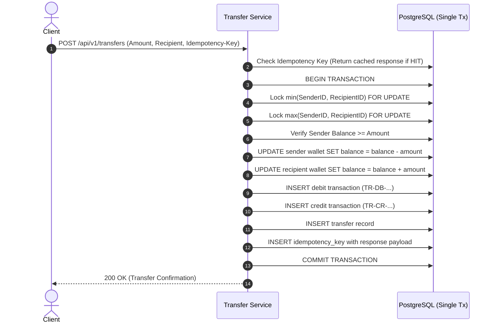

# GopherWallet 🦫💳

A high-performance, secure **Wallet & Transaction Management API in Go**, built strictly using the Go standard library for the HTTP routing and server layer, raw SQL with `pgxpool` for PostgreSQL interactions, and robust database transaction isolation.

---

## 🌟 Key Highlights

- **Standard Library HTTP (`net/http`):** Uses Go 1.22+ method-aware routing (`http.ServeMux`), zero 3rd-party web frameworks (no Gin, Chi, or Fiber).
- **Pure SQL (No ORM):** Direct, tuned PostgreSQL queries with `pgxpool.Pool` connection pooling.
- **Integer Currency Representation:** Monetary amounts stored exclusively as integer **kobo** (`BIGINT`) to eliminate floating-point rounding inaccuracies.
- **Race Condition Prevention:** Implements PostgreSQL row-level locking (`SELECT ... FOR UPDATE`) on wallet records.
- **Deadlock Avoidance in Transfers:** Enforces deterministic lock ordering (`min(walletA, walletB)` before `max(walletA, walletB)`) across concurrent transfers.
- **Idempotency Protection:** Prevents duplicate charges from network retries by checking SHA-256 request payload hashes against client-supplied idempotency keys.
- **Graceful Shutdown:** Cleans up active connections with context timeouts on `SIGINT` and `SIGTERM`.

---

## 🛠 Technology Stack

| Layer | Component | Description |
|---|---|---|
| **Language** | Go 1.26 | Standard library focused |
| **HTTP Routing** | `net/http` (`http.ServeMux`) | Method-aware routing & pattern matching |
| **Database** | PostgreSQL 16 | ACID transactions & row-level locking |
| **DB Driver** | `pgx/v5` (`pgxpool`) | High-performance connection pool |
| **Authentication** | JWT (`golang-jwt/jwt/v5`) | HMAC-SHA256 stateless tokens |
| **Password Hashing** | `bcrypt` (`golang.org/x/crypto`) | Cost factor 12 |
| **Testing** | `testing`, `httptest` | Concurrency race detection (`-race`) |
| **Containers** | Docker & Docker Compose | Multi-stage build & isolated PostgreSQL |

---

## 📐 Architecture & Directory Structure

```
gopherwallet/
├── cmd/
│   └── api/
│       └── main.go                 # App entrypoint & dependency injection
├── internal/
│   ├── config/                     # Environment variable parsing
│   │   └── config.go
│   ├── database/                   # pgxpool connection & migration runner
│   │   └── postgres.go
│   ├── middleware/                 # Logging, Recovery, Auth & Claims extraction
│   │   ├── auth.go
│   │   ├── logging.go
│   │   └── recovery.go
│   ├── response/                   # JSON envelopes & request decoding
│   │   └── response.go
│   ├── server/                     # HTTP server lifecycle & graceful shutdown
│   │   └── server.go
│   ├── transaction/                # Transactions, Transfers & Idempotency
│   │   ├── handler.go
│   │   ├── model.go
│   │   ├── repository.go
│   │   └── service.go
│   ├── user/                       # User auth, registration & profiles
│   │   ├── handler.go
│   │   ├── model.go
│   │   ├── repository.go
│   │   └── service.go
│   └── wallet/                     # Wallet balance queries
│       ├── handler.go
│       ├── model.go
│       ├── repository.go
│       └── service.go
├── migrations/                     # Sequential schema migrations
│   ├── 001_create_users.sql
│   ├── 002_create_wallets.sql
│   ├── 003_create_transactions.sql
│   ├── 004_create_transfers.sql
│   └── 005_create_idempotency_keys.sql
├── tests/                          # Integration and concurrency stress tests
│   ├── auth_test.go
│   ├── concurrency_test.go
│   ├── health_test.go
│   ├── registration_test.go
│   └── transaction_test.go
├── docker-compose.yml
├── Dockerfile
├── Makefile
└── go.mod
```

---

## 🔒 Concurrency & Transaction Integrity



### 1. Row-Level Locking (`SELECT ... FOR UPDATE`)
When debiting a wallet or executing a transfer, the wallet rows are locked exclusively within an active database transaction. Simultaneous withdrawal requests are serialized by PostgreSQL, preventing overdraw race conditions.

### 2. Deadlock Prevention via Deterministic Lock Ordering
If User A transfers to User B while User B simultaneously transfers to User A, locking sender-first would cause Tx 1 to hold A and wait for B, while Tx 2 holds B and waits for A (Deadlock).
**GopherWallet** resolves this by comparing UUID byte sequences and always acquiring the lock on `min(ID_A, ID_B)` first, followed by `max(ID_A, ID_B)`.

### 3. Idempotency Keys
Network drops between client and server can lead to duplicate transfer retries. By providing an `Idempotency-Key` header, repeated requests return the identical cached result with `X-Cache-Lookup: HIT`. Attempting to reuse an existing key with a modified payload produces a `409 Conflict`.

---

## 🚀 Quickstart

### Prerequisites
- Go 1.22+
- Docker & Docker Compose

### 1. Start PostgreSQL
```bash
make docker-up
```

### 2. Run Database Migrations and Start Server
```bash
make run
```
*Migrations in `migrations/*.sql` execute automatically on startup.*

### 3. Run Test Suite (with Race Detection)
```bash
make test-race
```

---

## 📡 API Reference

### Health Check
```bash
curl http://localhost:8080/health
```

### 1. Register User & Provision Wallet
Every user registration automatically creates an initial wallet with `0` balance in the same database transaction.
```bash
curl -X POST http://localhost:8080/api/v1/auth/register \
  -H "Content-Type: application/json" \
  -d '{
    "email": "ada@example.com",
    "password": "strongPassword123",
    "full_name": "Ada Lovelace"
  }'
```

### 2. Login
```bash
curl -X POST http://localhost:8080/api/v1/auth/login \
  -H "Content-Type: application/json" \
  -d '{
    "email": "ada@example.com",
    "password": "strongPassword123"
  }'
```
Response:
```json
{
  "token": "eyJhbGciOiJIUzI1NiIsInR5cCI6IkpXVCJ9...",
  "expires_at": "2026-11-25T05:00:00Z"
}
```

### 3. Get Wallet & Balance
```bash
curl http://localhost:8080/api/v1/wallet \
  -H "Authorization: Bearer <TOKEN>"

curl http://localhost:8080/api/v1/wallet/balance \
  -H "Authorization: Bearer <TOKEN>"
```

### 4. Credit Wallet (Deposit Simulation)
```bash
curl -X POST http://localhost:8080/api/v1/transactions/credit \
  -H "Authorization: Bearer <TOKEN>" \
  -H "Content-Type: application/json" \
  -d '{
    "amount": 1000000,
    "description": "Initial account deposit"
  }'
```
*Note: `amount` is in kobo (1,000,000 kobo = ₦10,000.00).*

### 5. Debit Wallet (Withdrawal)
```bash
curl -X POST http://localhost:8080/api/v1/transactions/debit \
  -H "Authorization: Bearer <TOKEN>" \
  -H "Content-Type: application/json" \
  -d '{
    "amount": 250000,
    "description": "Utility bill payment"
  }'
```

### 6. Transfer Funds (P2P with Idempotency)
```bash
curl -X POST http://localhost:8080/api/v1/transfers \
  -H "Authorization: Bearer <TOKEN>" \
  -H "Idempotency-Key: e82cf551-7360-4927-b5b5-fd609460599a" \
  -H "Content-Type: application/json" \
  -d '{
    "recipient_email": "bob@example.com",
    "amount": 300000,
    "description": "Project milestone share"
  }'
```

### 7. Transaction History
```bash
curl "http://localhost:8080/api/v1/transactions?page=1&page_size=10" \
  -H "Authorization: Bearer <TOKEN>"
```
